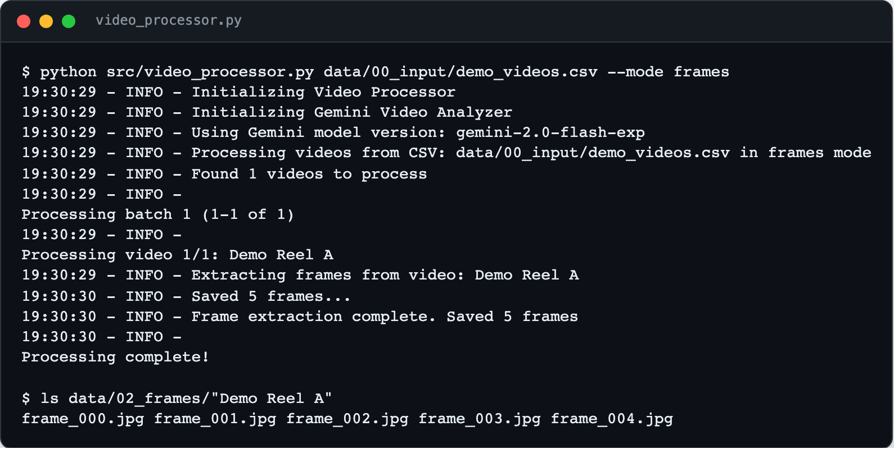
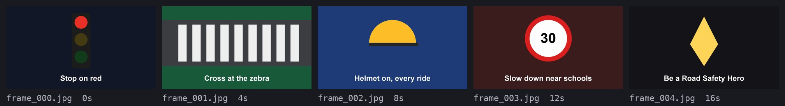

<div align="center">

<h1>Video Analysis System</h1>

<p><b>Score a batch of videos against a rubric.</b></p>

<p><i>Judging dozens of contest entries by hand is slow. This pipeline samples frames, has Gemini describe them, and fills in the score sheet.</i></p>

<h6>


-555555?style=flat-square)


</h6>

<a href="#how-it-works"><b>How it works</b></a> ·
<a href="#what-you-get"><b>What you get</b></a> ·
<a href="#run-it"><b>Run it</b></a>

<br><br>



<sub>Real run of the frame step on a generated 20-second demo reel. The Gemini steps were not run for this page.</sub>

</div>

<br>

## Why

It was built to help judge a batch of short road-safety reels against a fixed nine-part rubric
(focus, creativity, impact, visual appeal, theme, clarity, ethics, relevance, other remarks).
Watching every entry and writing a justification for every score takes hours. This pipeline
does a first pass: it looks at each video, scores it against the rubric with written
justification and feedback, and lines all the entries up in one comparison table. The prompts
are written for road-safety content; the rubric itself lives in a JSON file.

## How it works

<table>
<tr>
<td width="33%" valign="top">

**1 · Download and sample**

Reads a CSV of names and Google Drive links, downloads each video with `gdown`, and saves one
frame every 4 seconds with OpenCV.

</td>
<td width="33%" valign="top">

**2 · Describe and score**

Gemini describes each frame, then summarises the video, writes an overall analysis, and scores
it against `config/scoring_criteria.json` as JSON.

</td>
<td width="33%" valign="top">

**3 · Compare**

Score files are combined into a Markdown report and a CSV, with a table per criterion sorted
by score. This step makes no API calls.

</td>
</tr>
</table>

<div align="center">

<br><sub>The five frames from the run above, which is what Gemini would see. Demo video drawn for this page.</sub>
</div>

## What you get

- **One folder per stage.** `data/01_videos` to `data/06_comparative_analysis`, so any stage can be rerun alone with `--mode`.
- **Per-video report.** `04_individual_analysis/<name>_analysis.md` with the description and overall analysis.
- **Scores with reasons.** `05_scores/<name>_score.json` holds a score, justification and feedback per criterion, plus the total out of 50.
- **A comparison sheet.** `06_comparative_analysis/` gets a dated Markdown report and a CSV with key highlights and recommendations per video.
- **Rate limiting.** Requests are spaced at least a second apart, capped per minute from the config; frame requests retry after a minute on HTTP 429.
- **Cost.** A video sampled into *n* frames takes *n* + 3 Gemini requests.

## Known gaps

This was a one-off from December 2024 and has not been updated since.

- `google-generativeai` is now deprecated in favour of `google-genai`, and the configured model, `gemini-2.0-flash-exp`, was an experimental release. Expect to change both.
- Captions are not implemented; each video gets a "Captions not available" placeholder.
- The frame interval is fixed at 4 seconds in code; the `frame_extraction` config block is not read.
- Downloads call `venv/bin/gdown`, so the virtual environment must be named `venv` in the repo root.
- The comparison step reads `all_videos.csv` from the repo root, not the CSV passed on the command line.
- Only Google Drive links are supported.

## Run it

Needs a Gemini API key.

```bash
git clone https://github.com/parthchandak02/video-analysis-system.git
cd video-analysis-system
python -m venv venv && source venv/bin/activate
pip install -r requirements.txt
cp config/config.example.json config/config.json   # then add your key
```

```bash
python src/video_processor.py videos.csv --mode all        # download, frames, analysis, compare
python src/video_processor.py videos.csv --mode frames     # just sample frames, no API calls
python src/video_processor.py videos.csv --mode analysis   # score videos whose frames exist
python src/video_processor.py videos.csv --clean analysis  # wipe analysis and later stages first
```

The CSV has two columns, `Video Name` and `Video URL`; see `data/00_input/example_videos.csv`.

<details>
<summary><b>Configuration</b></summary>

| Key in `config/config.json` | |
|---|---|
| `gemini_api_key` | Your key |
| `model_version` | Gemini model name |
| `rate_limits.requests_per_minute` | Request cap per minute |

The rubric is `config/scoring_criteria.json`: a list of `name`, `description` and `max_marks`.
The comparison tables expect the nine criterion names it ships with.

</details>

<br>

<div align="center">
<sub>Built with OpenCV, pandas, gdown and the Gemini API.</sub>
</div>
